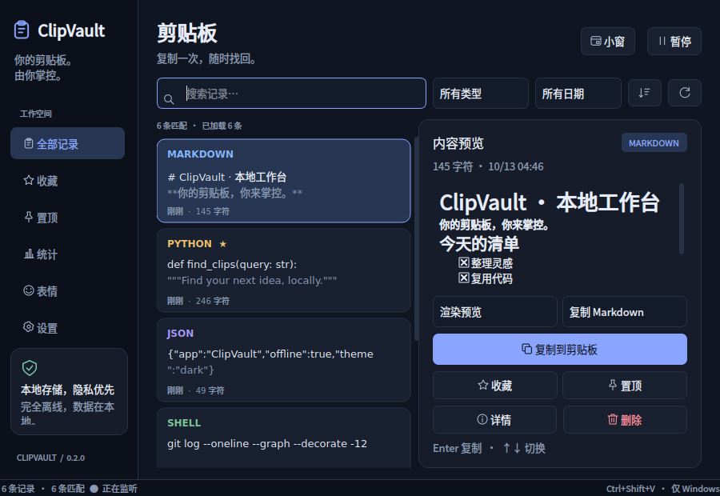
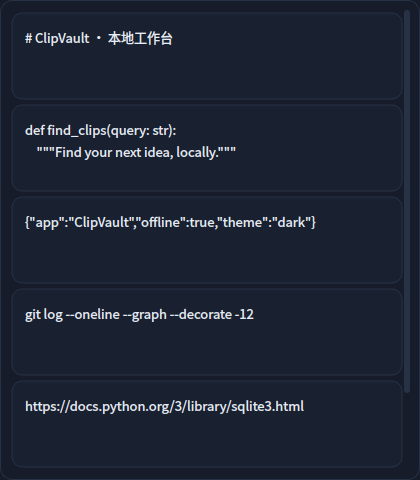

# ClipVault

Your Clipboard. Your Data. Your Control.

一款轻量、离线、注重隐私的 Windows 剪贴板管理器。

[English](README_EN.md) · [验证记录](docs/VALIDATION.md) · [Windows 实机清单](docs/WINDOWS_CHECKLIST.md)

- **完全离线，隐私优先**：本地 SQLite，无账号、遥测、云同步或 API Key。
- **快捷搜索，快速复用**：中文子串搜索、Code / TXT / MD 分类、日期筛选、收藏与置顶。
- **轻量简洁，开箱即用**：中英文界面、深浅主题、内容小窗、代码高亮和本地 Markdown 预览。

当前版本 **0.2.0 Preview 1**：[预览发布与 Windows 下载](https://github.com/fqxxzyw/ClipVault/releases/tag/v0.2.0-preview.1)。Linux 两组各 123 项测试通过，Windows 122 项通过，EXE 构建与隔离启动检查通过；[实际 CI](https://github.com/fqxxzyw/ClipVault/actions/runs/38339833962)。真实 Windows 10/11 桌面验收尚未完成。

## 真实运行截图

以下截图来自实际运行的 PySide6 程序，在 **Linux / Qt offscreen** 环境使用公开示例与临时数据库拍摄；不是效果图，也不代表 Windows 实机验证。图片页中的图片是生成于测试脚本的合成样例，文件页使用不存在的示例路径。




[英文深色](screenshots/clipvault-dark.png) · [英文浅色](screenshots/clipvault-light.png) · [设置](screenshots/clipvault-settings.png) · [统计](screenshots/clipvault-statistics.png) · [Emoji](screenshots/clipvault-emoji.png) · [图片](screenshots/clipvault-image.png) · [文件路径](screenshots/clipvault-files.png)

## 功能与使用方式

在任意应用复制内容，ClipVault 通过系统剪贴板变化事件自动保存。单击主窗口记录查看内容；双击、Enter 或复制按钮将它重新放到剪贴板，再到目标应用按 Ctrl+V。程序不执行内容、不自动注入粘贴。

| 功能 | 使用方式 |
| --- | --- |
| 分类与搜索 | 顶部类型筛选选 Code（Python / JS / JSON / Shell / SQL）、TXT、Markdown、URL、图片或文件；搜索多个关键词按 AND 匹配 |
| 日期筛选 | 所有日期、今天、最近 7/30 天或自定义区间；按最近复制时间，使用本地日期，结束日期包含当天 |
| Markdown | 显示渲染预览或原始文本；复制格式选 **复制 Markdown**（原文）或 **复制纯文本**（去 Markdown 格式）。普通文本可点“按 Markdown 预览”并持久化类型 |
| 内容小窗 | 点击“小窗”或托盘菜单打开；只显示内容。单击或 Enter 复制，成功后隐藏；MD 右键可选择复制格式；滚动到底部增量加载 |
| Emoji | 表情页提供离线常用表情；点击或键盘 Space 复制。监听开启时保存到历史，暂停时只复制 |
| 图片 | 本地 PNG 保存、缩略图、比例预览、原图重新复制；SHA-256 去重，删除/清理同步删除图片数据 |
| 文件 | 只保存本地文件路径，显示统一文件图标；复制按钮复制路径文本。不会读取、上传或移动文件，也不恢复文件复制/剪切操作 |
| 收藏/置顶 | 独立导航、重启保留；清空与自动清理保护收藏和置顶 |
| 统计 | 新复制次数、ClipVault 复用次数、复制字符、行数、常见 Emoji、图片和文件选择次数；日期范围和确认重置 |
| 语言/主题 | 设置中选择跟随系统、简体中文或 English，保存后立即生效；深浅主题、字号、透明度均可保存 |
| 动效 | 页面与列表变化提供 200ms 过渡、按钮 Hover / Pressed / Focus 状态；设置“减少动态效果”，同时读取 Windows 客户区动画偏好 |

统计从本版本启用后开始，不推算旧历史。重复复制计入次数但历史去重；暂停和被隐私过滤的内容不计数。字符数使用 Python Unicode 长度，行数使用 `splitlines()`，Emoji 计数合并常见 ZWJ、肤色和旗帜序列，但不覆盖全部 Unicode 字素。**粘贴次数不可观测**：系统剪贴板没有粘贴事件，本版不记录键盘输入，因此不把复用次数伪装成粘贴统计。统计仅存本地数字，不存事件原文。

## 快捷键

| 操作 | 效果 |
| --- | --- |
| Ctrl+Shift+V | Windows 全局显示/隐藏；设置可改绑，并选择打开完整窗口或小窗 |
| ↑ / ↓、Enter | 切换记录、复制选中内容（默认保留原始 Markdown） |
| Esc | 隐藏快捷面板；无托盘时主窗口最小化，小窗始终隐藏 |
| Alt+F（小窗） | 回到完整窗口 |
| Alt+拖动（小窗） | 移动无边框小窗 |
| Tab / Shift+Tab、Space | 键盘访问控件与操作按钮 |

设置中的“失去焦点后隐藏”用于快捷面板与小窗。正常最小化驻留托盘；关闭窗口默认隐藏到托盘，可设置关闭时退出。无托盘环境关闭主窗口会退出，避免程序无法恢复。剪贴板启动时不会读取已有内容。

## 安装与源码运行

目标：Windows 10/11 x64、Python 3.11+。安装依赖与构建可需要网络，安装后的核心功能离线运行。

```powershell
git clone https://github.com/fqxxzyw/ClipVault.git
cd ClipVault
py -3.11 -m venv .venv
.\.venv\Scripts\python.exe -m pip install -e ".[dev]"
.\.venv\Scripts\python.exe -m clipvault
# 后台运行
.\.venv\Scripts\pythonw.exe -m clipvault --background
```

只运行软件可安装 `-e .`，无需开发依赖。默认数据位于 `%LOCALAPPDATA%\ClipVault\history.sqlite3` 与 `settings.json`，不在项目目录。图片也在 SQLite 中。设置里可打开数据目录；开发测试可用 `--data-dir` 指定隔离目录。Linux 数据目录为 `$XDG_DATA_HOME/ClipVault` 或 `~/.local/share/ClipVault`；全局快捷键和开机启动仅 Windows 提供。

下载已验证的 [Windows x64 完整 ZIP](https://github.com/fqxxzyw/ClipVault/actions/runs/38339833962/artifacts/11785609502) 需要登录 GitHub；**完整解压 ZIP 后运行 ClipVault.exe**，保留 `_internal`、`licenses` 与所有声明，不需要安装 Python。Actions 产物有保留期限，过期后从源码构建或重新运行 CI。此版本 ZIP 的 SHA-256：`5c2680db56302fda2bec14560509c508170e9ddd8aa29d558ca3546127ce7260`。二进制未上传为 Release 附件，发布页提供下载入口。

## 限制与隐私

文字最多 **100,000 字符**，预览前 **20,000 字符**，详情保留全文。空白、NUL 和无效代理字符跳过；Windows CRLF 转为 LF。图片最多 **16,000,000 像素**、单边 **8192 像素**、PNG **8 MiB**；文件一次最多 **100 个路径**、总路径长度 100,000 字符。不保存动画图片序列，不做 OCR 或文件内容索引。

默认过滤常见私钥、明确密码字段和 API Token，但会漏判、误判。**图片没有敏感内容识别**，路径也可能泄露私人信息；可在设置关闭图片/文件记录，复制保密资料前暂停。全部历史与图片未加密；SQLite `secure_delete` 和清空后的 WAL checkpoint 不保证 SSD、备份或快照安全擦除。

自动清理可选永不、7/30/90 天及普通记录数量上限，收藏/置顶受保护；删除单条或确认清空普通历史会同步移除关联图片。大量图片可明显增加磁盘占用，按需调整保留策略。统计单独确认重置。

核心无网络请求、账户、遥测或同步。Markdown 不加载网络、本地、相对或 data 图片，不打开链接，内嵌 HTML 禁用；“在浏览器中打开”只对用户主动选择的 HTTP(S) URL 调用默认浏览器。不会执行剪贴板代码或把原文写入日志/异常。

中文短关键词和特殊字符采用参数化 LIKE 回退，会扫描历史；默认普通记录上限 5,000，几十万条记录的中文子串查询不承诺即时。英文较长关键词可走 FTS5 trigram 候选查询，再按字面验证。数据库、分类、PNG 编码和统计在独立 Qt 工作线程，主线程通过信号接收结果；搜索防抖 180ms、分页 50 条。

真实 Windows 10/11 监听、系统图片/文件 MIME、物理快捷键、托盘、多显示器/DPI、开机启动与系统减少动效偏好仍需实机验证。Linux offscreen 集成测试不能替代它们。表情的呈现依赖系统字体；Windows 使用 Segoe UI Emoji。缺少字形时显示可识别的名称，复制的仍是原始表情。Linux 图形桌面并非正式支持目标。

## EXE 打包

```powershell
powershell -ExecutionPolicy Bypass -File scripts/build_windows.ps1
# 或使用已安装环境
.\.venv\Scripts\python.exe scripts/build.py
.\.venv\Scripts\python.exe scripts/smoke_bundle.py
```

输出 `dist/ClipVault/ClipVault.exe` 及完整依赖，默认 onedir、无额外控制台窗口，包含 Qt 插件、SVG/ICO、Pygments 和许可证。Linux 不可交叉生成 Windows EXE；`--allow-linux` 仅产生 Linux 构建检查产物。可选 `--onefile` 未验证。启动检查使用临时数据、不读取真实剪贴板，验证窗口、数据库、高亮、Markdown、图片存储/读取与退出。

## 技术架构与测试

`core/` 负责监听、原生快捷键、分类与隐私；`database/` 负责 SQLite、版本迁移、FTS 与参数化查询；`services/` 负责串行后台工作、清理和安全 Markdown 转换；`ui/` 负责主窗、预览、小窗、统计、表情、翻译与可中断动效；`utils/` 负责配置、用户目录和 HKCU 启动项。运行依赖只有 PySide6、Pygments。

```powershell
ruff check .
ruff format --check .
$env:QT_QPA_PLATFORM="offscreen"
python -m pytest -q
python -m clipvault --smoke-test
python scripts/capture_screenshots.py --offscreen
```

当前本地测试：**123 passed / 3 skipped**，跳过真实 Windows 桌面测试。原生验证请阅读 [清单](docs/WINDOWS_CHECKLIST.md)，设置 `QT_QPA_PLATFORM=windows`、`CLIPVAULT_DESKTOP_TESTS=1` 后运行对应测试。CI 在 Ubuntu Python 3.11 / 3.12 执行检查，在 Windows 构建并验证 onedir、上传完整产物；不假定 Runner 具备真实交互桌面。结果以 [验证记录](docs/VALIDATION.md) 和实际 Actions 为准。

## 贡献与许可

欢迎小范围、可复现的 Issue / PR。用临时数据库和公开示例写测试，附验证命令；UI 变化提供真实截图，不提交真实历史、图片、个人路径或密钥。发布步骤见 [RELEASE.md](docs/RELEASE.md)。

项目采用 [MIT License](LICENSE)。Qt、Pygments 等保留各自许可，见 [THIRD_PARTY_NOTICES.md](THIRD_PARTY_NOTICES.md)，打包目录包含 LGPL/GPL 文本和对应第三方声明。
