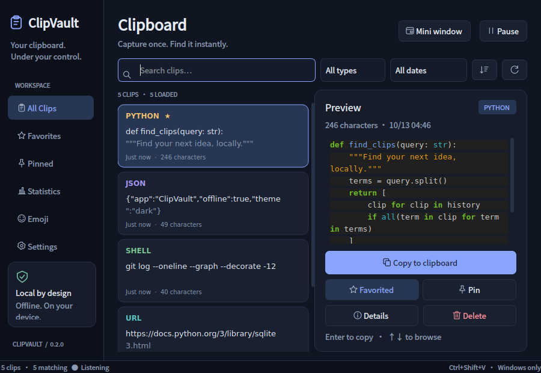
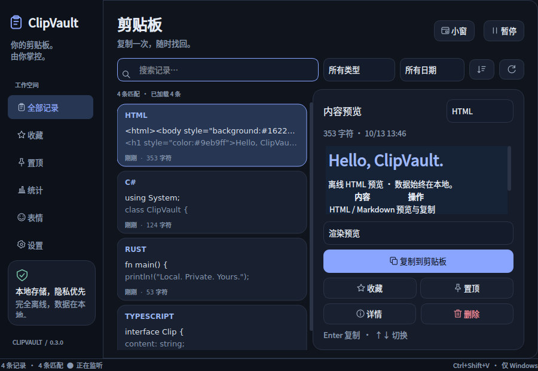
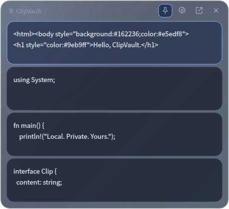
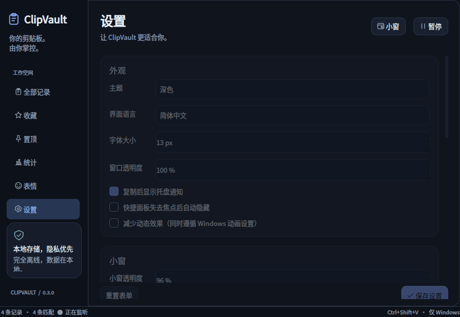

# ClipVault

Your Clipboard. Your Data. Your Control.

A lightweight, privacy-first clipboard manager for Windows.

[中文](README.md) · [Validation](docs/VALIDATION.md) · [Windows checklist](docs/WINDOWS_CHECKLIST.md)

- **Offline and private:** local SQLite, no account, telemetry, sync or API keys.
- **Find and reuse:** Chinese substring search, Code / TXT / Markdown categories, dates, favorites and pins.
- **Simple desktop workflow:** bilingual UI, dark/light themes, a content-only mini picker, highlighting and local Markdown preview.

Current release: [**0.3.0 Preview 1**](https://github.com/fqxxzyw/ClipVault/releases/tag/v0.3.0-preview.1). Windows x64 EXE build and frozen startup/exit smoke passed CI. Interactive Windows acceptance remains pending.

## Actual screenshots

Captured from the running PySide6 app on **Linux / Qt offscreen**, using public samples and a disposable profile. These are neither mockups nor Windows desktop validation. The image sample is drawn by the test script; file samples refer to nonexistent paths.






[Light](screenshots/clipvault-light.png) · [Settings](screenshots/clipvault-settings.png) · [Statistics](screenshots/clipvault-statistics.png) · [Emoji](screenshots/clipvault-emoji.png) · [Images](screenshots/clipvault-image.png) · [File paths](screenshots/clipvault-files.png)

## Features and workflow

Copy in another application. ClipVault captures clipboard change events and saves locally. Select a main-window record to inspect it; double-click, press Enter or click Copy to restore it, then use Ctrl+V in the destination app. Content is never executed and paste is never injected.

| Feature | Behavior |
| --- | --- |
| Search and categories | Literal multi-term AND search, Chinese substring fallback, Code group (Python/JS/JSON/Shell/SQL), TXT, Markdown, URLs, images and files |
| Dates | All, today, last 7/30 days or custom inclusive local dates; based on last copied time |
| Markdown | Rendered/source view; **Copy Markdown** keeps the original, **Copy plain text** removes Markdown formatting. Plain text can be explicitly marked as Markdown and the type persists |
| Mini picker | Normal drag movement and edge/corner resizing, saved geometry, topmost pin, independent 40–100% opacity and glass menu; pinned copying stays visible; Markdown copy modes and paging |
| HTML / languages | Static HTML/source view; 24 code/config languages including C/C++/C#, TypeScript, Java, Go, Rust, PHP, Kotlin and Swift; manual selector and Auto detect reclassification |
| Emoji | Offline common emoji; click or Space to copy, with history recording when active |
| Images | Local PNG storage, thumbnails, proportional preview, original-image copy and SHA-256 deduplication; deletion also removes image data |
| Files | Save local file paths, display consistent file icons, copy paths as text. No file contents are read, uploaded, moved or restored as copy/cut operations |
| Favorites and pins | Separate navigation, persistent flags and protection from automatic cleanup/ordinary-history clearing |
| Statistics | Captured copy events, ClipVault reuse events, copied characters/lines/common emoji, images and file selections; date period and confirmed reset |
| Settings | System/Chinese/English language, dark/light, font, opacity, shortcut, startup, notifications and retention; apply on save |
| Motion | Interruptible 220ms page slide/fade and list transitions; smooth pointer-following glass highlights, hover/pressed/focus states; reduced-motion setting and Windows client-area animation preference |

Counters start with this version, not inferred from old history. Repeated copies count as events while history deduplicates. Paused or filtered copies are excluded. Character counts use Python Unicode length, lines use `splitlines()`. Common ZWJ/skin-tone/flag emoji sequences count together; this is not complete Unicode grapheme segmentation. **Paste count is unavailable:** the clipboard provides no paste event and this app does not record keyboard input. Reuse is never presented as a paste count. Only local numeric aggregates are stored.

## Shortcuts

| Action | Result |
| --- | --- |
| Ctrl+Shift+V | Native Windows global toggle; configurable combination and full/mini target |
| Up / Down, Enter | Select and copy; keyboard/default copying preserves original Markdown |
| Esc | Hide quick panel; main-window minimize fallback without a tray; mini always hides |
| Alt+F in mini | Return to full window |
| Normal drag / edge drag in mini | Move / resize without Alt; dragging does not copy |
| Tab / Shift+Tab, Space | Keyboard navigation and button activation |

Auto-hide applies to quick panels and unpinned mini windows. Pinned copying and focus loss keep the picker visible; Esc/Close can still hide it. Closing normally hides to the tray, with optional quit-on-close; without a tray, closing the main window exits. Startup never reads the existing clipboard.

## Install from source

Target: Windows 10/11 x64, Python 3.11+. Installation/building may need internet; the installed core works offline.

```powershell
git clone https://github.com/fqxxzyw/ClipVault.git
cd ClipVault
py -3.11 -m venv .venv
.\.venv\Scripts\python.exe -m pip install -e ".[dev]"
.\.venv\Scripts\python.exe -m clipvault
# Start in the tray
.\.venv\Scripts\pythonw.exe -m clipvault --background
```

Runtime-only installation: `pip install -e .`. User data: `%LOCALAPPDATA%\ClipVault\history.sqlite3` and `settings.json`, outside the source tree; images are stored in SQLite too. Settings opens the data folder. `--data-dir` supports isolated profiles. Linux uses `$XDG_DATA_HOME/ClipVault` or `~/.local/share/ClipVault`; hotkeys/startup integration are Windows-only.

Download the [verified Windows x64 ZIP](https://github.com/fqxxzyw/ClipVault/releases/download/v0.3.0-preview.1/ClipVault-0.3.0-preview.1-windows-x64.zip) from Release Assets without signing in. **Extract the complete ZIP**, then run `ClipVault.exe` without Python installed. Keep `_internal`, `licenses` and notices. The complete ZIP is attached to the release. SHA-256: `98c3d617681abd8190e8e69ed16b447b059b86551eb2ed71280bb6f2d3f84e59`. The release includes the complete Windows binary ZIP.

## Privacy and limits

Text limit: **100,000 characters**, preview: **20,000**; Details keeps full content. Blank, NUL and invalid surrogate text is skipped; Windows CRLF becomes LF. Images: **16,000,000 pixels**, **8192 per side**, **8 MiB PNG**. Files: **100 paths** and 100,000 total path characters per event. No animated-image sequences, OCR or file-content indexing.

Default secret heuristics recognize common keys, password fields and tokens, with false positives and false negatives. **Images have no sensitive-content detection**; paths can disclose private information. Disable image/file capture in Settings or pause before confidential copies. SQLite and images are unencrypted. `secure_delete` and WAL checkpoints do not guarantee secure erasure from SSDs, snapshots or backups.

Cleanup supports never/7/30/90 days and ordinary-history count limits; favorites/pins are protected. Deleting or clearing ordinary history removes linked images. Many images can consume considerable disk space; adjust retention. Statistics reset requires separate confirmation.

HTML uses local Qt rich text, not a full browser: scripts, external resources and navigation are disabled. Common text/styles/tables work; Flex/Grid, web animations and interaction do not. Recognition remains conservative; ambiguous clips can be assigned manually.

Documented DWM APIs request Windows 11 dark captions, rounded system corners and Mica/Acrylic. The mini picker also draws translucent glass, soft light and reflective borders. Native Windows 11 blur requires physical-desktop verification; other platforms fall back to translucent styling, not Apple's optical liquid-glass refraction. Reduced motion disables custom page slides and animated highlights; idle windows have no animation timer.

No core network requests, accounts or telemetry. Markdown denies network, local, relative and data image resources, disables embedded HTML and does not open links. Explicit HTTP(S) browser actions may cause the user's browser to connect. Clipboard code is never run; content is never logged or included in exceptions.

Chinese short/special searches use parameterized LIKE and may scan history. The default ordinary-history limit is 5,000; immediate queries over hundreds of thousands of clips are not promised. Longer ASCII terms can use FTS5 trigram candidates plus literal validation. Database/classification/PNG work is serialized in a QThread; UI results use signals, 180ms search debounce and 50-row pages.

Native Windows clipboard image/file MIME, physical keyboard, tray, startup, displays/DPI and reduced-motion behavior still need desktop checks. Linux offscreen tests cannot replace them. Emoji appearance depends on OS fonts (Segoe UI Emoji on Windows); missing glyphs fall back to readable names while copying the original emoji. Linux graphical desktop support is not a release target.

## Build an EXE

```powershell
powershell -ExecutionPolicy Bypass -File scripts/build_windows.ps1
# Or use an existing environment
.\.venv\Scripts\python.exe scripts/build.py
.\.venv\Scripts\python.exe scripts/smoke_bundle.py
```

Default: `dist/ClipVault/ClipVault.exe` plus dependencies, windowed onedir, Qt plugins/icons, Pygments and notices. Linux cannot cross-build a Windows EXE; `--allow-linux` makes a Linux verification bundle only. Optional `--onefile` remains unverified. Isolated startup checks validate window, database, highlighting, Markdown, image storage/readback and exit without reading the real clipboard.

## Architecture and testing

`core/`: events, native hotkeys, classification/privacy. `database/`: SQLite migrations, FTS and parameterized queries. `services/`: serialized worker, cleanup and safe Markdown conversion. `ui/`: main/mini, preview, tools pages, offline translation and interruptible motion. `utils/`: settings, user paths and HKCU startup. Runtime dependencies: PySide6 and Pygments only.

```powershell
ruff check .
ruff format --check .
$env:QT_QPA_PLATFORM="offscreen"
python -m pytest -q
python -m clipvault --smoke-test
python scripts/capture_screenshots.py --offscreen
```

Local result: **158 passed / 3 skipped**, the latter are opt-in Windows desktop tests. Use the [checklist](docs/WINDOWS_CHECKLIST.md), `QT_QPA_PLATFORM=windows` and `CLIPVAULT_DESKTOP_TESTS=1` for native checks. CI checks Ubuntu Python 3.11/3.12 and builds/smokes/uploads the Windows onedir bundle. It does not assume an interactive runner. See [validation](docs/VALIDATION.md) and actual Actions.

## Contribute and license

Send small, reproducible issues/PRs. Use disposable profiles and public samples, include test commands and actual UI screenshots, and never commit private clips/images/paths or credentials. See [release instructions](docs/RELEASE.md).

[MIT](LICENSE) covers project code; dependencies retain their licenses. See [THIRD_PARTY_NOTICES.md](THIRD_PARTY_NOTICES.md). Bundles include LGPL/GPL text and corresponding third-party notices.
