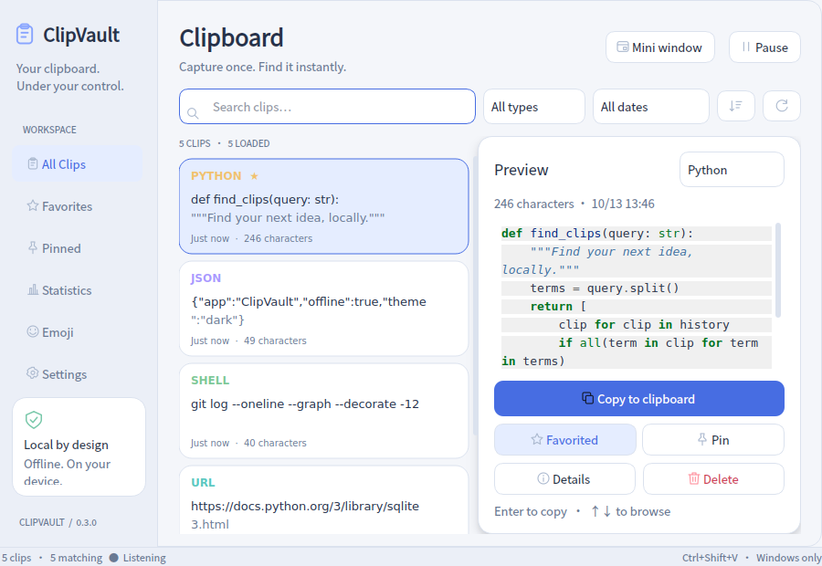
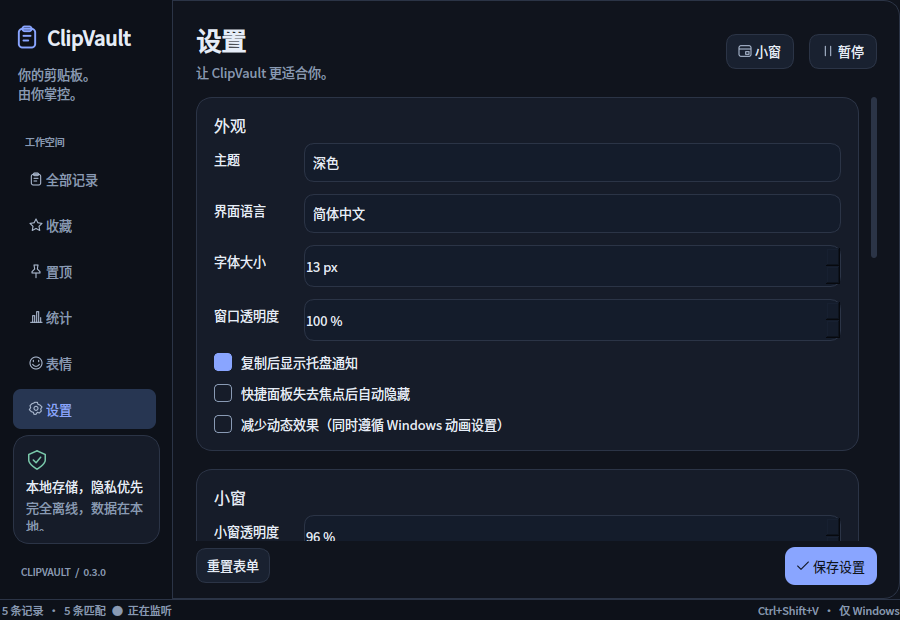

# ClipVault

Your Clipboard. Your Data. Your Control.

A lightweight, privacy-first clipboard manager for Windows.

[中文](README.md) · [Validation](docs/VALIDATION.md) · [Windows checklist](docs/WINDOWS_CHECKLIST.md)

- **Offline and private:** local SQLite, no account, cloud sync, telemetry or API key.
- **Find and reuse:** instant keyboard access, multi-term and Chinese substring search, favorites, pins and syntax highlighting.
- **Simple desktop workflow:** PySide6 interface, dark/light themes, tray controls and Windows native hotkeys.

> Public preview: 0.1.0 Preview 1. [Download the complete Windows x64 bundle](https://github.com/fqxxzyw/ClipVault/releases). Both Linux CI jobs passed 90 tests; Windows CI passed 89 tests, built the EXE and passed isolated startup checks. Real Windows 10/11 clipboard, physical keyboard, tray, startup and multi-monitor behavior still require desktop verification. See the validation report.

## Actual application screenshots

These are captures of the running PySide6 window, with public example clips and an isolated temporary database on **Linux/offscreen**. They are not mockups or Windows validation screenshots.





## Features

| Feature | Implementation |
| --- | --- |
| Capture | Event-driven `QClipboard.dataChanged`; bounded native Windows Unicode reader and limited contention retries |
| Storage | SQLite WAL, SHA-256 deduplication, copy timestamps, persistent favorites and pins, 50-row pages |
| Search | Literal AND substring matching, Chinese fallback, type and scope filters, 180 ms debounce, time sorting |
| Classification | Text, HTTP(S) URLs, Python, JavaScript, JSON, shell and SQL; conservative local heuristics |
| Preview | Pygments highlighting, full-text details, JSON formatting and copy, explicit browser opening |
| Privacy | Pause without backfill, secret heuristics enabled by default, age/quantity cleanup, confirmed ordinary-history clearing |
| Settings | Theme, font size, opacity, shortcut, retention, notifications, quick-panel auto-hide, close behavior, Windows user startup |

Only text is recorded. Images and copied files are excluded. Text over **100,000 characters** is skipped entirely. Windows CRLF becomes LF; other whitespace is preserved. Startup does not read the existing clipboard. Nothing copied is executed.

## Install and run from source

Target: Windows 10/11 x64, Python 3.11+, graphical desktop. Dependency installation/building may need internet access; the installed application's core operates offline.

From the project directory in PowerShell:

```powershell
py -3.11 -m venv .venv
.\.venv\Scripts\python.exe -m pip install -e ".[dev]"
.\.venv\Scripts\python.exe -m clipvault
```

Use your installed Python version if 3.11 is unavailable. Install `-e .` without the development extra for runtime-only dependencies. To start hidden:

```powershell
.\.venv\Scripts\pythonw.exe -m clipvault --background
```

Default data: `%LOCALAPPDATA%\ClipVault\history.sqlite3` and `settings.json`, outside the source tree. Use Settings → Open data folder. An explicit `--data-dir` allows an isolated development profile. Linux uses `$XDG_DATA_HOME/ClipVault` or `~/.local/share/ClipVault`; native global hotkeys and startup integration are Windows-only.

See [Releases](https://github.com/fqxxzyw/ClipVault/releases) for the preview and Windows download link, or download the [verified Windows onedir artifact](https://github.com/fqxxzyw/ClipVault/actions/runs/38194979657/artifacts/11722853005). GitHub requires sign-in to download Actions artifacts. **Extract the entire ZIP into a separate folder** before launching `ClipVault.exe`; Python installation is not required. Keep `_internal`, `licenses` and all notices. The Windows CI build passed an offscreen startup check; interactive Windows 10/11 verification remains pending.

Compare the ZIP's SHA-256 with `a8d8ac528e857e339144422c8356815528295af5ffbc2713af6767eb7326c89d`. The ZIP is hosted as an Actions artifact and has not been attached to a Release; artifacts have retention limits. Build from source or rerun CI when an artifact expires.

## Use and shortcuts

Copy text in another application. Select a record to inspect it; double-click, press Enter or click Copy to put it on the system clipboard, then paste with Ctrl+V in the destination app. ClipVault does not inject a paste into another application.

| Shortcut/action | Effect |
| --- | --- |
| Ctrl+Shift+V | Windows global show/hide; configurable |
| Up / Down | Move selection from search or list |
| Enter | Copy selection; a hotkey-opened quick panel then hides |
| Esc | Hide to tray, or minimize if no tray is available |
| Tray click/double-click | Open window |
| Pause / Resume | Suspend new captures; no backfill on resume |

Global shortcuts require Ctrl, Alt or Win and support letters, digits, F1–F11 and selected navigation keys. Conflicts retain the old registration. No global keyboard hook is installed. Reserved OS shortcuts may fail. Closing defaults to the tray; without a tray it exits so the app remains accessible.

Pins stay above other records. Favorites and pins survive age/quantity cleanup and Clear ordinary history. Defaults: **5,000 ordinary clips** and **30 days**. Total records may exceed the ordinary limit. Cleanup runs at startup, after captures/settings changes and hourly.

## Search and performance boundaries

Whitespace separates AND terms. `%`, `_` and quotes are literal, not SQL patterns.

- FTS5 trigram accelerates simple ASCII terms of at least three characters when supported; results are verified for identical literal substring semantics.
- Chinese, short/special-character terms and environments without FTS5 use parameterized `LIKE` queries. Chinese substrings are supported.
- Leading-wildcard `LIKE` scans records. Latency grows with record count and text size; the 5,000 ordinary-record default limits normal use. The configurable maximum is 100,000, and unbounded saved favorites can still slow searches. No benchmark claims are made.
- SQLite, classification and Pygments rendering run in one dedicated Qt worker thread. Signals deliver results to the UI, stale results are discarded, and list rows are loaded incrementally. Highlighted previews are bounded to 20,000 characters; Details shows the full clip.

## Privacy

Default rules recognize common private-key headers, explicit password fields, GitHub/API tokens, AWS keys and bearer fields. They can miss secrets or reject harmless examples. Pause before copying confidential content; this is not a password manager.

The SQLite database is **not encrypted**. Anyone with access to the current user's files may read it. Protect the OS account and disk. Clipboard text is never written to logs or error dialogs; the application creates no content log.

Clear ordinary history requires confirmation and excludes favorites and pins. `secure_delete` is enabled and clearing attempts a WAL checkpoint, but deletion does not guarantee secure erasure from SSDs, snapshots or backups. Delete protected clips individually. Close the app before backing up/removing the data directory.

Core functionality makes no network requests. An explicit Open in browser action sends an HTTP(S) URL to the user's browser, which may then connect to the internet. No remote resources are rendered from clipboard content.

## Build a Windows EXE

```powershell
powershell -ExecutionPolicy Bypass -File scripts/build_windows.ps1

# Or use an existing environment:
.\.venv\Scripts\python.exe scripts/build.py
.\.venv\Scripts\python.exe scripts/smoke_bundle.py
```

Default output: `dist/ClipVault/ClipVault.exe` plus dependencies. `--windowed` removes the extra console. Qt plugins, SVG/ICO icons, Pygments lexers and Windows version metadata are included.

Optional, unverified single-file build:

```powershell
.\.venv\Scripts\python.exe scripts/build.py --onefile
.\.venv\Scripts\python.exe scripts/smoke_bundle.py dist/ClipVault.exe
```

PyInstaller must run on Windows to produce a Windows executable. `--allow-linux` explicitly permits a **Linux** bundle check; it is not an EXE. The smoke check creates an isolated temporary profile, does not read the clipboard or register a hotkey, and cannot validate an interactive desktop.

## Architecture

| Module | Responsibility |
| --- | --- |
| `main.py`, `app.py` | Startup, single-instance lock, controller, lifecycle and tray |
| `core/` | Clipboard protocol/adapters, native hotkey API, privacy rules, conservative classification |
| `database/` | Models, parameterized repository, transactional schema migrations |
| `services/` | QThread database operations, search planning, cleanup, safe HTML previews |
| `ui/` | Main window, list model/delegate, preview and settings widgets, themes and icons |
| `utils/`, `resources/` | User paths, atomic configuration, current-user Windows startup, SVG/ICO assets |
| `tests/`, `scripts/` | Logic/Qt tests, opt-in Windows desktop integration, build and screenshot tooling |

SQLite uses WAL, a 2.5-second busy timeout and bounded background retries. Final failures report that an operation was not completed. `PRAGMA user_version` guards migrations; future schemas are refused without overwriting data. Corrupt databases are not silently replaced.

## Tests and CI

```powershell
.\.venv\Scripts\python.exe -m ruff check .
.\.venv\Scripts\python.exe -m ruff format --check .
.\.venv\Scripts\python.exe -m pytest -q
.\.venv\Scripts\python.exe -m clipvault --smoke-test
```

Default tests use offscreen Qt and disposable profiles. Real Windows integration is opt-in on an interactive desktop: follow [the checklist](docs/WINDOWS_CHECKLIST.md). Hosted CI performs Linux tests and Windows onedir builds plus isolated packaged startup checks; it does not certify physical keyboard, tray or multiple monitors.

Actual screenshots can be regenerated with `python scripts/capture_screenshots.py --offscreen`. It uses a temporary database and public examples, but briefly changes the Qt/system clipboard. Pause a running personal instance first.

## Known limitations

- The EXE was built and smoke-tested on Windows Server 2025 CI. Native Windows 10/11 clipboard, hotkey, tray, startup and multi-monitor behavior still require interactive desktop testing.
- Text only, no encryption, auto-paste, image history or synchronization.
- Heuristics do not fully parse every language or find every secret; JSON formatting replaces whitespace.
- OS notifications may coalesce extremely rapid changes; locked clipboard retries read the newest available state. Capturing every overwritten intermediate state is not guaranteed.
- Persistent clipboard/DB contention produces an error. Pending retry work is in memory and may not survive exit.
- A second instance is refused rather than using IPC to bring the first one forward.
- Unsigned binaries need Windows SmartScreen/antivirus checks before publication.

## GitHub release and contribution

Repository: [fqxxzyw/ClipVault](https://github.com/fqxxzyw/ClipVault). Check [GitHub Actions](https://github.com/fqxxzyw/ClipVault/actions) for build results. Follow [release steps](docs/RELEASE.md), complete Windows validation, then publish the complete onedir ZIP and checksums. Repository description:

```text
A lightweight, offline-first clipboard manager for Windows with instant search, syntax highlighting, and privacy protection.
```

Topics: `clipboard-manager`, `windows`, `python`, `pyside6`, `sqlite`, `desktop-app`, `productivity`, `open-source`, `privacy`.

Open a branch, run Ruff and pytest, and add meaningful tests for capture/privacy/storage changes. Report platform versions and non-sensitive reproduction steps; never attach real history databases or credentials.

[MIT License](LICENSE). Dependencies retain their own licenses; see [third-party notices](THIRD_PARTY_NOTICES.md).
