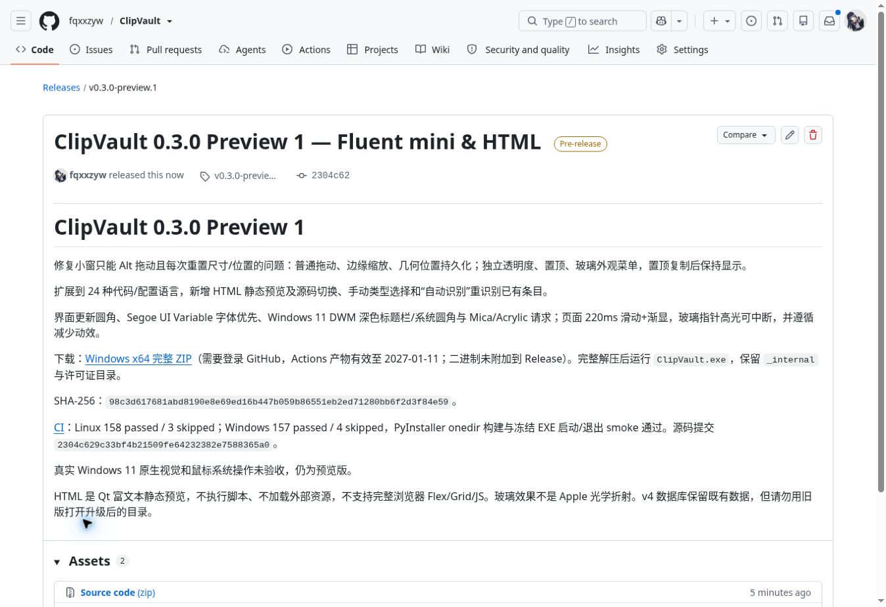

# ClipVault 0.3.0 验证记录

验证日期：2026-10-13。Linux / Python 3.12 / PySide6 / Qt offscreen 环境。

## 本机结果

- 158 passed / 3 skipped，0 failed；Ruff 检查及格式检查通过。
- 源码隔离 smoke 通过，窗口、数据库、SVG/ICO、Pygments、Markdown、PNG 编码/读取与退出通过。
- 新增 35 项覆盖：20 种新增语言样例、普通文本回退、全语言 lexer、Code 分组、手动类型和重新识别、安全 HTML 渲染、拖动不复制、边缘缩放、尺寸位置保存、独立透明度和置顶、置顶复制保持显示、DWM 参数版本守卫、页面滑动恢复和减少动效。
- v4 数据库标记保留既有历史/收藏/图片/统计；新增语言标识对旧版本不兼容，旧版会拒绝打开而非错误渲染。不要降级使用同一数据目录。
- 真实 Qt 截图包括 HTML、C# 高亮、圆角玻璃小窗。GIF 来自实际运行的 QPropertyAnimation 帧，不是静态效果图或生成设计稿。

## Windows

[CI 38357562691](https://github.com/fqxxzyw/ClipVault/actions/runs/38357562691) 对源码 `2304c629c33bf4b21509fe64232382e7588365a0` 全部通过。Ubuntu Python 3.11/3.12 各 158 passed / 3 skipped；Windows Python 3.11 为 157 passed / 4 skipped（另跳过 Linux 专用检查）。Ruff、PyInstaller onedir 构建及冻结 EXE 隔离启动/退出 smoke 通过。

[Windows x64 ZIP](https://github.com/fqxxzyw/ClipVault/releases/download/v0.3.0-preview.1/ClipVault-0.3.0-preview.1-windows-x64.zip)：54,422,792 字节，SHA-256 `98c3d617681abd8190e8e69ed16b447b059b86551eb2ed71280bb6f2d3f84e59`，产物有效至 2027-01-11。下载后 CRC、236 文件、x64 PE GUI subsystem、Qt Windows 插件与许可证检查通过；未包含历史数据库或用户设置。二进制已附加到 Release，可公开下载，无需登录；Actions 副本仍有保留期限。CI 没有交互式桌面验收，也未增加 contents-write 权限。

## 未验证与限制

真实 Windows 10/11 的鼠标原生移动/缩放、DWM 圆角/Mica/Acrylic、窗口置顶、独立透明度、多显示器/DPI、物理快捷键与托盘仍需实机验收。offscreen 测试只验证 Qt 路径及 fallback，不代表真实系统原生视觉效果。

HTML 为本地 Qt 静态富文本，禁用脚本和外部资源，不能当作完整浏览器的 CSS/Flex/Grid/JavaScript 预览。玻璃为半透明高光外观与支持平台的原生背景请求，不声称实现 Apple 光学折射。图片无敏感识别；粘贴次数不可观测。

## 发布凭证

[0.3.0 Preview 1](https://github.com/fqxxzyw/ClipVault/releases/tag/v0.3.0-preview.1) 已发布，标签指向已验证源码 `2304c629c33bf4b21509fe64232382e7588365a0`。

